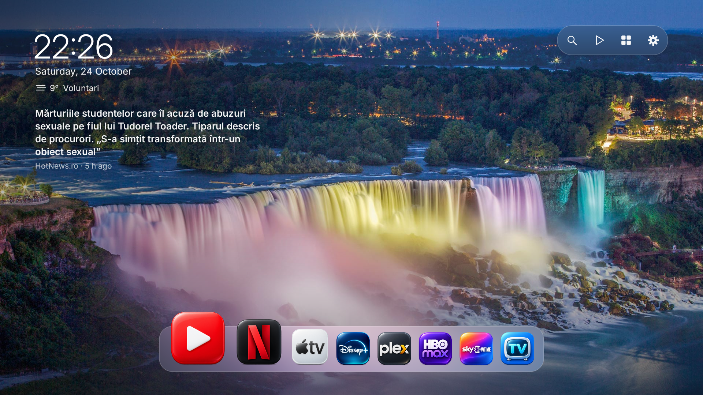
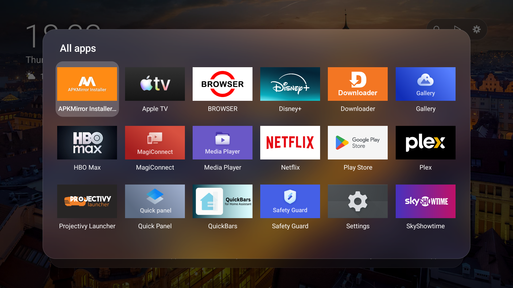

# minimal-launcher

A quiet home screen for Google TV / Android TV in a macOS-inspired style: a photo, the time, the weather and your apps on a clear frosted-glass dock that magnifies the focused app (with a little wiggle) and soft UI sounds, built for the remote. Inspired by [CleanFrame](https://github.com/nthnclrk/CleanFrame) (Samsung Tizen), rewritten for Android TV.



## Features

- **Dynamic wallpaper**, changing every 10 minutes with a slow crossfade, from a source chosen under Frame settings → Wallpaper:
  - **Bing** daily images, **NASA** Image Library (Hubble, Webb, Earth from orbit), **Unsplash**, **Pexels**, or all of them **Mixed**. Photos are cached on the TV, so it still works offline.
  - **Apple Aerials**: Apple TV's aerial screensaver videos, streamed at 1080p from Apple's servers while the home screen is open (about 7–10 GB an hour). Nothing of Apple's is bundled in this repository.
  - Unsplash and Pexels need a free API key in `keys.properties` on the TV (see *Wallpaper keys*).
- **Typeface**: [Inter](https://rsms.me/inter/) (SIL OFL, `frame/fonts/`), the open font closest to SF Pro; the big centred clock uses [Antonio](https://fonts.google.com/specimen/Antonio) (SIL OFL), close to the compressed iOS lock-screen clock.
- **Top left**: clock, date and current weather for the TV's location ([Open-Meteo](https://open-meteo.com), no API key). The location comes from Android's location services (Wi-Fi based on a TV, coarse permission only); without it, Bucharest is used.
- **Top right**: Google search (voice or keyboard), Play Store, All apps, TV settings.
- **Dock** you edit with the remote (up to 10 apps), plus an **Apps** panel with everything installed (top-bar button or the remote's Menu key). Starts with YouTube, Netflix, Apple TV, Disney+, Plex, HBO Max, SkyShowtime and live TV.
- **News** under the weather, as plain text: Google News headlines for the country the TV is in, rotating every 15 s. Press ▲ from the dock to select it, ◀ ▶ to browse, OK to open the article. Hold OK on ⚙ for settings (on/off, topic).
- **HDMI inputs** in the dock: they head the Apps panel (hold OK to add); in edit mode ▲ picks an icon (HDMI, PlayStation, Xbox, Switch).
- **Icon library** of sketch-style logos for 30 popular apps, in macOS style (default, `frame/icons-mac/`), white (minimal) or color: switch under Frame settings → Icon style, matched by package name; apps without one show their name as a bold wordmark.
- Frosted glass rendered from a pre-blurred copy of the wallpaper, so it stays smooth on TV hardware.
- No ads, no recommendations, no accounts. Framework-only Java: no AndroidX, no Gradle.



## Build

Needs the Android SDK (platform 34, build-tools 35.0.0) and a JDK (tested with 23). The script calls aapt2, javac, d8, zipalign and apksigner directly.

```powershell
.\frame\build.ps1            # -> frame\out\frame.apk
.\frame\build.ps1 -Install   # build, install on the TV connected over adb, open it
```

The first build creates a local `debug.keystore` (not committed).

## Install on a TV

1. Enable Developer options and network/ADB debugging on the TV, then `adb connect <tv-ip>:5555`.
2. `.\frame\build.ps1 -Install`
3. Make it the Home app:
   ```powershell
   adb shell cmd package set-home-activity com.frame.home/.HomeActivity
   ```
   On Google TV the stock launcher may also need to be disabled (see `tv.ps1 launcher`).
4. Allow location when the TV asks (for local weather), or grant it over adb:
   ```powershell
   adb shell pm grant com.frame.home android.permission.ACCESS_COARSE_LOCATION
   ```

## Edit the dock

| Remote | Does |
|---|---|
| Hold **OK** on a dock app | Edit mode |
| **◀ ▶** (in edit mode) | Move it |
| **▼** (in edit mode) | Remove it |
| **OK** / **Back** | Done |
| Hold **OK** in *Apps* | Add that app to the dock |

The dock is saved on the TV. `DEFAULT_DOCK` in `HomeView.java` is only the starting point.

## Icon library

Icons are white-on-transparent PNGs named after the app's package, e.g. `com.netflix.ninja.png` (`apps.png` is the All apps button).

- **Bundled**: put the full-size PNG in `frame/icons/` (white) or `frame/icons-color/` (color). The build ships 256px copies.
- **On the TV, no rebuild**: push it to the launcher's folder; it's picked up the next time Home opens and wins over a bundled icon with the same name.
  ```powershell
  adb push com.example.app.png /sdcard/Android/data/com.frame.home/files/icons/
  ```

Find an app's package with `adb shell pm list packages | findstr <name>`.

## Wallpaper keys

Unsplash and Pexels need a free API key. Put them in a `keys.properties` file (never commit it) and copy it to the TV:

```text
unsplash=YOUR_ACCESS_KEY
pexels=YOUR_KEY
```

```powershell
adb push keys.properties /sdcard/Android/data/com.frame.home/files/
```

Sources without a key are skipped in the settings.

## Customise

| What | Where |
|---|---|
| Weather fallback location | `Weather.java` (`FALLBACK_LAT`, `FALLBACK_LON`, `FALLBACK_PLACE`) |
| Wallpaper interval / sources | `HomeView.WALLPAPER_INTERVAL`, `Wallpapers.MARKETS` |

## tv.ps1: debloat helper

`tv.ps1` disables ads, trackers (e.g. Samba TV) and promo apps over adb with `pm disable-user`, and can swap the Home launcher. Everything is reversible:

```powershell
.\tv.ps1 connect -Ip 192.168.1.50
.\tv.ps1 scan                 # list packages, change nothing
.\tv.ps1 debloat              # dry run; add -Apply to disable
.\tv.ps1 restore -Apply       # re-enable what it disabled (per TV)
.\tv.ps1 stock-launcher -Apply
```

Tested on a Sony XR-55A83J (Google TV, Android 12) and a TCL Smart TV Pro (Google TV, Android 14).

## License

Code and docs: [MIT](LICENSE). App names and logos belong to their owners and are not covered by the license; the sketch-style icons are for personal use. Wallpapers are streamed from Bing and are not part of this repository.
